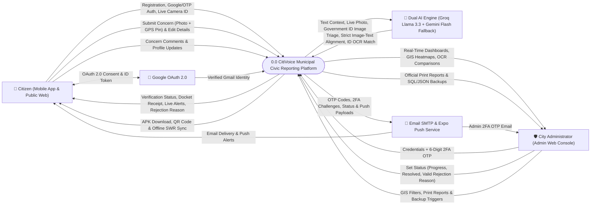
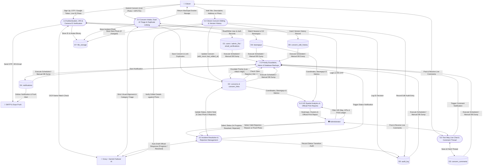
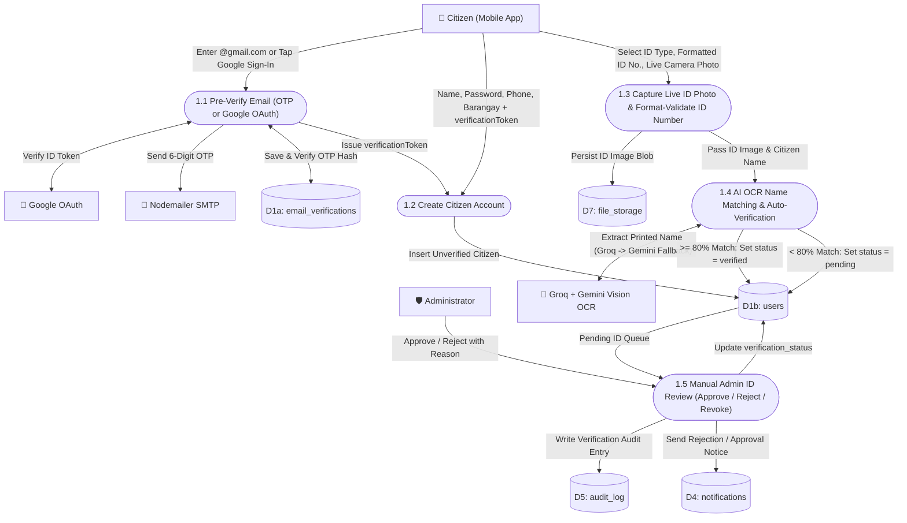
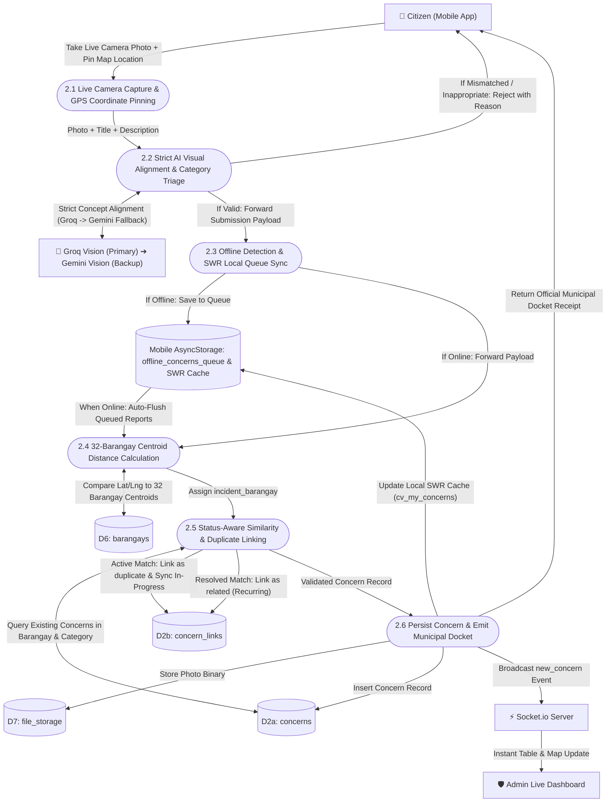
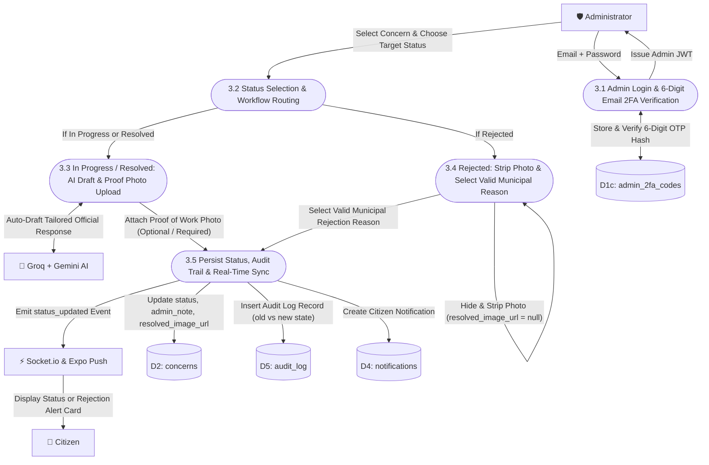
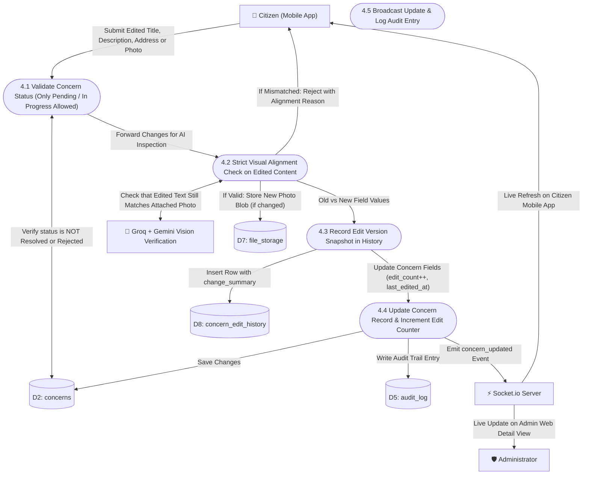

# 📊 CitiVoice — Entity-Relationship Diagram (ERD) & Data Flow Diagrams (DFD)

This document provides the complete database **Entity-Relationship Diagram (ERD)** and multi-level **Data Flow Diagrams (DFD Level 0, Level 1, Level 2.1, 2.2, 2.3, and 2.4)** for the **CitiVoice** municipal civic reporting platform (**City of Kabankalan, Negros Occidental**).

---

## 📑 Table of Contents

1. [Entity-Relationship Diagram (ERD)](#-1-entity-relationship-diagram-erd)
   - [1.1 Visual Mermaid ERD](#11-visual-mermaid-erd)
   - [1.2 Database Relationships & Cardinality Summary](#12-database-relationships--cardinality-summary)
   - [1.3 Table & Entity Dictionary](#13-table--entity-dictionary)
2. [Data Flow Diagrams (DFD)](#-2-data-flow-diagrams-dfd)
   - [2.1 DFD Symbol Legend](#21-dfd-symbol-legend)
   - [2.2 DFD Level 0 — Context Diagram](#22-dfd-level-0--context-diagram)
   - [2.3 DFD Level 1 — System Overview Diagram](#23-dfd-level-1--system-overview-diagram)
   - [2.4 DFD Level 2.1 — Citizen Registration & Camera-Only ID Verification](#24-dfd-level-21--citizen-registration--camera-only-id-verification)
   - [2.5 DFD Level 2.2 — Concern Intake, Dual-AI Failover Triage & Duplicate Linking](#25-dfd-level-22--concern-intake-dual-ai-failover-triage--duplicate-linking)
   - [2.6 DFD Level 2.3 — Admin 2FA, Resolution Lifecycle & Rejection Workflow](#26-dfd-level-23--admin-2fa-resolution-lifecycle--rejection-workflow)
   - [2.7 DFD Level 2.4 — Citizen Concern Editing & Version History Tracking](#27-dfd-level-24--citizen-concern-editing--version-history-tracking)
   - [2.8 Data Store Dictionary](#28-data-store-dictionary)

---

## 🗄️ 1. Entity-Relationship Diagram (ERD)

### 1.1 Visual Mermaid ERD

The schema below reflects all **11 production InnoDB tables** defined in [`backend/database/schema.sql`](backend/database/schema.sql) and synchronized via [`backend/database/autoMigrate.js`](backend/database/autoMigrate.js).

```mermaid
erDiagram
    USERS {
        int id PK "AUTO_INCREMENT"
        varchar name "NOT NULL"
        varchar email UK "NOT NULL, UNIQUE"
        varchar password_hash "NOT NULL"
        varchar phone "NULL"
        varchar barangay "NULL (Home Barangay)"
        varchar address "NULL (Street / Purok)"
        enum role "admin | citizen"
        tinyint is_super_admin "0 | 1 (Primary Admin)"
        enum verification_status "unverified | pending | verified | rejected"
        tinyint is_verified "0 | 1"
        varchar id_type "NULL (PhilSys, LTO, UMID, etc.)"
        varchar id_number "NULL"
        text id_image_url "NULL"
        text avatar_url "NULL"
        text fcm_token "NULL (Expo Push Token)"
        text rejection_reason "NULL"
        varchar reset_otp "NULL (Bcrypt Hash)"
        datetime reset_otp_expires "NULL"
        datetime submitted_at "NULL"
        datetime verified_at "NULL"
        datetime created_at "DEFAULT CURRENT_TIMESTAMP"
        datetime updated_at "ON UPDATE CURRENT_TIMESTAMP"
    }

    ADMIN_2FA_CODES {
        int user_id PK,FK "REFERENCES users(id) ON DELETE CASCADE"
        varchar otp_hash "NOT NULL"
        datetime expires_at "NOT NULL"
        datetime created_at "DEFAULT CURRENT_TIMESTAMP"
    }

    EMAIL_VERIFICATIONS {
        varchar email PK "Target Gmail Address"
        varchar otp_hash "NOT NULL"
        datetime expires_at "NOT NULL"
        tinyint is_verified "0 | 1"
        datetime created_at "DEFAULT CURRENT_TIMESTAMP"
        datetime updated_at "ON UPDATE CURRENT_TIMESTAMP"
    }

    BARANGAYS {
        int id PK "AUTO_INCREMENT"
        varchar name UK "NOT NULL, UNIQUE (32 Barangays)"
        datetime created_at "DEFAULT CURRENT_TIMESTAMP"
        datetime updated_at "ON UPDATE CURRENT_TIMESTAMP"
    }

    CONCERNS {
        int id PK "AUTO_INCREMENT"
        varchar title "NOT NULL"
        text description "NOT NULL"
        varchar category "NOT NULL"
        enum priority "High | Medium | Low"
        enum status "Pending | In Progress | Resolved | Rejected"
        text image_url "NULL (Incident Camera Photo)"
        text resolved_image_url "NULL (Resolution Proof; NULL if Rejected)"
        text location_address "NULL"
        decimal location_lat "DECIMAL(10,7)"
        decimal location_lng "DECIMAL(10,7)"
        int user_id FK "REFERENCES users(id) ON DELETE SET NULL"
        varchar user_name "Citizen Name Snapshot"
        varchar user_barangay "Citizen Home Barangay"
        varchar incident_barangay "GPS-Matched Incident Barangay"
        text admin_note "Official Resolution / Rejection Note"
        datetime admin_viewed_at "NULL"
        int edit_count "DEFAULT 0"
        datetime last_edited_at "NULL"
        tinyint is_validated "DEFAULT 0"
        datetime validated_at "NULL"
        varchar validated_by_name "NULL"
        datetime created_at "DEFAULT CURRENT_TIMESTAMP"
        datetime updated_at "ON UPDATE CURRENT_TIMESTAMP"
    }

    CONCERN_EDIT_HISTORY {
        int id PK "AUTO_INCREMENT"
        int concern_id FK "REFERENCES concerns(id) ON DELETE CASCADE"
        int edited_by FK "REFERENCES users(id) ON DELETE CASCADE"
        varchar edited_by_name "Citizen / Admin Name Snapshot"
        varchar edited_by_role "citizen | admin"
        varchar old_title "Previous Title"
        varchar new_title "Updated Title"
        text old_description "Previous Description"
        text new_description "Updated Description"
        varchar old_category "Previous Category"
        varchar new_category "Updated Category"
        text old_location_address "Previous Address"
        text new_location_address "Updated Address"
        text old_image_url "Previous Photo URL"
        text new_image_url "Updated Photo URL"
        text change_summary "Human-readable changes summary"
        datetime created_at "DEFAULT CURRENT_TIMESTAMP"
    }

    CONCERN_LINKS {
        int id PK "AUTO_INCREMENT"
        int source_concern_id FK "REFERENCES concerns(id) ON DELETE CASCADE"
        int target_concern_id FK "REFERENCES concerns(id) ON DELETE CASCADE"
        enum link_type "duplicate | related"
        decimal similarity_score "DECIMAL(5,2)"
        datetime created_at "DEFAULT CURRENT_TIMESTAMP"
    }

    CONCERN_COMMENTS {
        int id PK "AUTO_INCREMENT"
        int concern_id FK "REFERENCES concerns(id) ON DELETE CASCADE"
        int user_id FK "REFERENCES users(id) ON DELETE CASCADE"
        varchar user_name "Author Name Snapshot"
        text comment "NOT NULL"
        varchar image_url "NULL (Optional Attachment)"
        datetime created_at "DEFAULT CURRENT_TIMESTAMP"
    }

    NOTIFICATIONS {
        int id PK "AUTO_INCREMENT"
        int user_id FK "REFERENCES users(id) ON DELETE CASCADE"
        int concern_id FK "REFERENCES concerns(id) ON DELETE CASCADE"
        varchar title "NOT NULL"
        text message "NOT NULL"
        tinyint is_read "0 | 1"
        datetime created_at "DEFAULT CURRENT_TIMESTAMP"
    }

    AUDIT_LOG {
        int id PK "AUTO_INCREMENT"
        varchar entity_type "concern | user | barangay"
        int entity_id "Target Record ID"
        varchar action "status_change | citizen_edit | verify | etc."
        int changed_by FK "REFERENCES users(id) ON DELETE SET NULL"
        varchar changed_by_name "Actor Name Snapshot"
        json old_value "Previous State JSON"
        json new_value "Updated State JSON"
        datetime created_at "DEFAULT CURRENT_TIMESTAMP"
    }

    FILE_STORAGE {
        int id PK "AUTO_INCREMENT"
        varchar filename UK "NOT NULL, UNIQUE"
        varchar mimetype "image/jpeg | image/png"
        longblob data "Binary Image Payload"
        timestamp created_at "DEFAULT CURRENT_TIMESTAMP"
    }

    %% Relationships
    USERS ||--o| ADMIN_2FA_CODES : "has active 2FA code"
    USERS ||--o{ CONCERNS : "submits"
    USERS ||--o{ CONCERN_EDIT_HISTORY : "performs edit"
    USERS ||--o{ CONCERN_COMMENTS : "authors"
    USERS ||--o{ NOTIFICATIONS : "receives"
    USERS ||--o{ AUDIT_LOG : "performs action"
    USERS }o..|| EMAIL_VERIFICATIONS : "verifies email via"
    BARANGAYS ||..o{ USERS : "resides in (by name)"
    BARANGAYS ||..o{ CONCERNS : "located in (user/incident barangay)"
    CONCERNS ||--o{ CONCERN_EDIT_HISTORY : "versioned in"
    CONCERNS ||--o{ CONCERN_COMMENTS : "contains thread"
    CONCERNS ||--o{ NOTIFICATIONS : "triggers alert"
    CONCERNS ||--o{ CONCERN_LINKS : "source concern"
    CONCERNS ||--o{ CONCERN_LINKS : "target concern"
    CONCERNS ||..o{ AUDIT_LOG : "tracked by (entity_id)"
    FILE_STORAGE ||..o{ USERS : "stores id_image_url / avatar_url"
    FILE_STORAGE ||..o{ CONCERNS : "stores image_url / resolved_image_url"
    FILE_STORAGE ||..o{ CONCERN_EDIT_HISTORY : "stores old/new image blobs"
```

---

### 1.2 Database Relationships & Cardinality Summary

| Parent Entity | Child Entity | Cardinality | Foreign Key / Join Column | Referential Action |
|---------------|--------------|-------------|---------------------------|--------------------|
| `users` | `admin_2fa_codes` | `1 : 0..1` | `admin_2fa_codes.user_id -> users.id` | `ON DELETE CASCADE` |
| `users` | `concerns` | `1 : N` | `concerns.user_id -> users.id` | `ON DELETE SET NULL` |
| `users` | `concern_edit_history` | `1 : N` | `concern_edit_history.edited_by -> users.id` | `ON DELETE CASCADE` |
| `users` | `concern_comments` | `1 : N` | `concern_comments.user_id -> users.id` | `ON DELETE CASCADE` |
| `users` | `notifications` | `1 : N` | `notifications.user_id -> users.id` | `ON DELETE CASCADE` |
| `users` | `audit_log` | `1 : N` | `audit_log.changed_by -> users.id` | `ON DELETE SET NULL` |
| `concerns` | `concern_edit_history` | `1 : N` | `concern_edit_history.concern_id -> concerns.id` | `ON DELETE CASCADE` |
| `concerns` | `concern_comments` | `1 : N` | `concern_comments.concern_id -> concerns.id` | `ON DELETE CASCADE` |
| `concerns` | `notifications` | `1 : N` | `notifications.concern_id -> concerns.id` | `ON DELETE CASCADE` |
| `concerns` | `concern_links` (Source) | `1 : N` | `concern_links.source_concern_id -> concerns.id` | `ON DELETE CASCADE` |
| `concerns` | `concern_links` (Target) | `1 : N` | `concern_links.target_concern_id -> concerns.id` | `ON DELETE CASCADE` |
| `barangays` | `users` / `concerns` | `1 : N` (Logical) | `barangays.name = users.barangay / concerns.incident_barangay` | Logical Reference |
| `file_storage` | `users` / `concerns` / `edit_history` | `1 : 1` (Logical) | `file_storage.filename` referenced in media URLs | Persistent Binary Store |

---

### 1.3 Table & Entity Dictionary

1. **`users`**: Stores `citizen` and `admin` accounts, contact details, assigned home barangay, street/purok address, `is_super_admin` flag, password reset OTP hashes, live-captured government ID metadata, verification states (`unverified`, `pending`, `verified`, `rejected`), and Expo push token (`fcm_token`).
2. **`admin_2fa_codes`**: Holds active bcrypt-hashed 6-digit OTP codes and 10-minute expiration timestamps required for Administrator Two-Factor Authentication.
3. **`email_verifications`**: Tracks pre-registration 6-digit OTP codes sent to citizen `@gmail.com` addresses prior to account creation.
4. **`barangays`**: Master reference list of the **32 official barangays** of Kabankalan City for resident assignment and geographic GPS centroid distance matching.
5. **`concerns`**: Core civic incident table storing report title, description, category, priority (`Low`, `Medium`, `High`), lifecycle status (`Pending`, `In Progress`, `Resolved`, `Rejected`), GPS coordinates (`location_lat`, `location_lng`), citizen barangay vs. nearest pinned `incident_barangay`, camera evidence (`image_url`), resolution proof (`resolved_image_url`, automatically cleared if `Rejected`), official `admin_note`, `edit_count`, and `last_edited_at`.
6. **`concern_edit_history`**: Comprehensive version history tracking citizen modifications to concerns prior to resolution (records previous/new title, description, category, address, photo, and audit timestamps).
7. **`concern_links`**: Self-referencing join table linking duplicate and recurring reports with a `similarity_score` (`duplicate` for active tickets, `related` for resolved incidents).
8. **`concern_comments`**: Stores real-time two-way conversation messages and optional image attachments between the reporting citizen and municipal administrators.
9. **`notifications`**: Stores citizen in-app notification records (status updates, admin replies, priority escalations, ID verification results) with read/unread tracking.
10. **`audit_log`**: Immutable JSON-backed ledger recording every administrative status transition, citizen edit, priority escalation, and ID verification decision.
11. **`file_storage`**: Stores binary image payloads (`LONGBLOB`) alongside disk storage, ensuring uploaded ID photos, avatars, and concern images persist across ephemeral cloud container restarts.

---

## 🔄 2. Data Flow Diagrams (DFD)

### 2.1 DFD Symbol Legend

| Component | Representation in Diagrams | Description |
|-----------|----------------------------|-------------|
| **External Entity** | `["👤 Citizen"]` / `["🛡️ Administrator"]` | Actors or external third-party cloud services |
| **Process** | `(["1.0 Process Name"])` | Transformation, validation, AI triage, or business logic |
| **Data Store** | `[("D1: Table Name")]` | Persistent MySQL database table or local offline cache |
| **Data Flow** | `-->|Data Payload|` | Directed movement of requests, events, or database records |

---

### 2.2 DFD Level 0 — Context Diagram

The **Context Diagram (Level 0)** represents **CitiVoice** as a unified system interacting with citizens, city administrators, and external AI/cloud services, featuring automatic AI failover between **Groq** and **Google Gemini**.

---

### 2.3 DFD Level 1 — System Overview Diagram

**DFD Level 1** decomposes the platform into its **7 primary functional processes** across **8 MySQL Data Stores (`D1`–`D8`)**.

---

### 2.4 DFD Level 2.1 — Citizen Registration & Camera-Only ID Verification

---

### 2.5 DFD Level 2.2 — Concern Intake, Dual-AI Failover Triage & Duplicate Linking

---

### 2.6 DFD Level 2.3 — Admin 2FA, Resolution Lifecycle & Rejection Workflow

---

### 2.7 DFD Level 2.4 — Citizen Concern Editing & Version History Tracking

---

### 2.8 Data Store Dictionary

| Data Store ID | Physical Implementation | Contents & Purpose |
|---------------|-------------------------|--------------------|
| **`D1`** | MySQL: `users`, `admin_2fa_codes`, `email_verifications` | Citizen and administrator profiles, credentials, 2FA OTP hashes, pre-registration OTP states, and government ID verification records. |
| **`D2`** | MySQL: `concerns`, `concern_links` | Civic incident reports, GPS coordinates, 32-barangay matching, lifecycle status, resolution photos, edit counters, and AI duplicate links. |
| **`D3`** | MySQL: `concern_comments` | Chronological two-way live conversation messages and image attachments between citizens and administrators. |
| **`D4`** | MySQL: `notifications` | In-app notification records linked to citizens and concerns with read/unread tracking and push dispatch states. |
| **`D5`** | MySQL: `audit_log` | Immutable JSON-backed administrative change history (`old_value`, `new_value`, `changed_by`) for full institutional accountability. |
| **`D6`** | MySQL: `barangays` | Master reference table of the **32 official barangays** of Kabankalan City with centroid coordinates. |
| **`D7`** | MySQL: `file_storage` + Disk `/uploads` | Hybrid binary image store (`LONGBLOB`) ensuring ID photos, avatars, incident photos, and resolution proof survive cloud container restarts. |
| **`D8`** | MySQL: `concern_edit_history` | Dedicated version history tracking citizen modifications to concerns prior to resolution (old vs new title, description, address, and photo). |
| **`Mobile Cache`** | Mobile `AsyncStorage` | Offline-first Stale-While-Revalidate (SWR) cache (`cv_user`, `cv_my_concerns_*`, `cv_concern_detail_*`, `cv_notifications_*`, `offline_concerns_queue`). |
