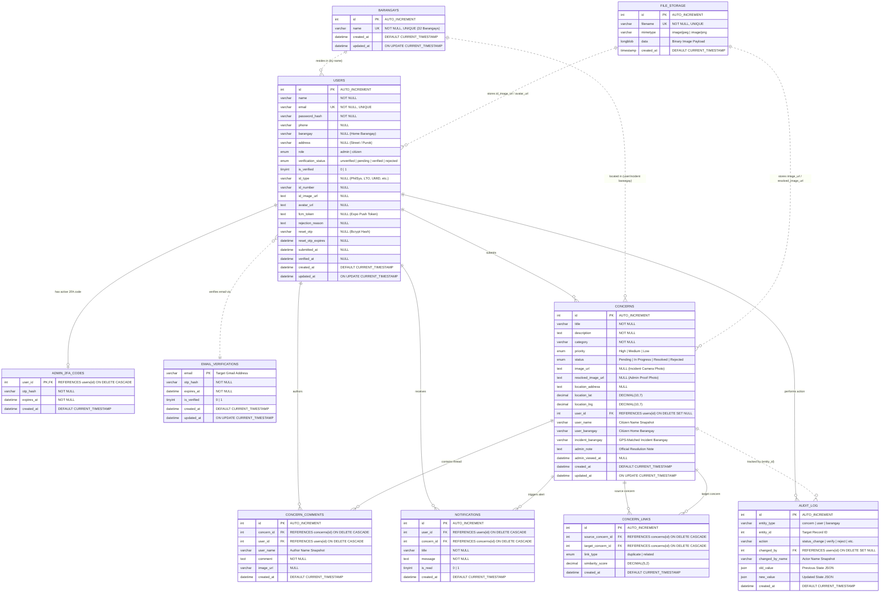
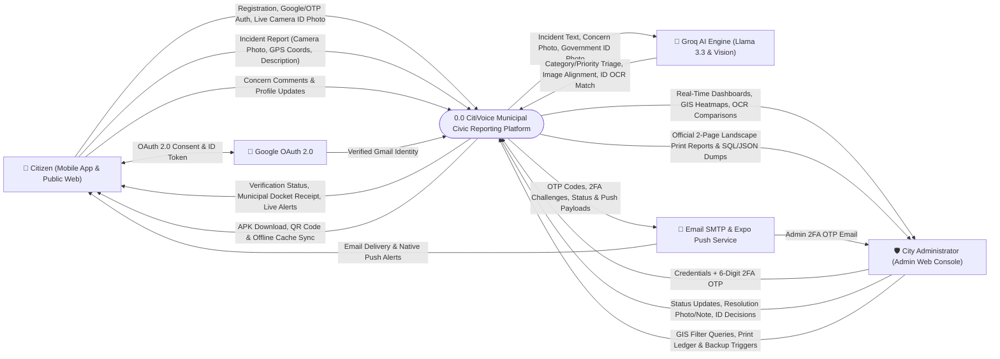
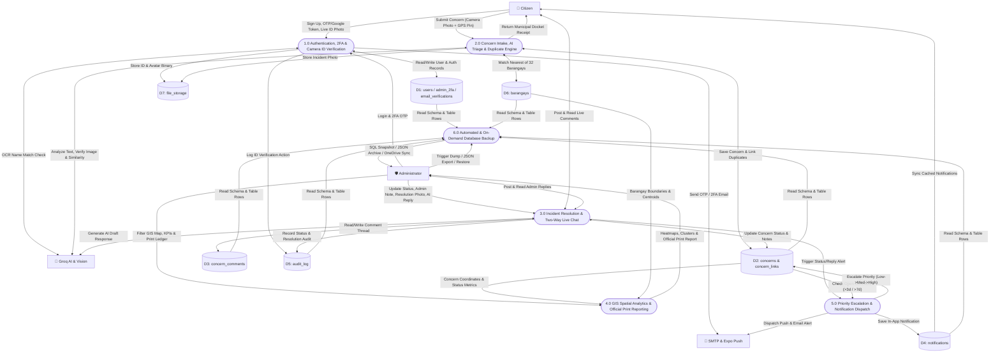
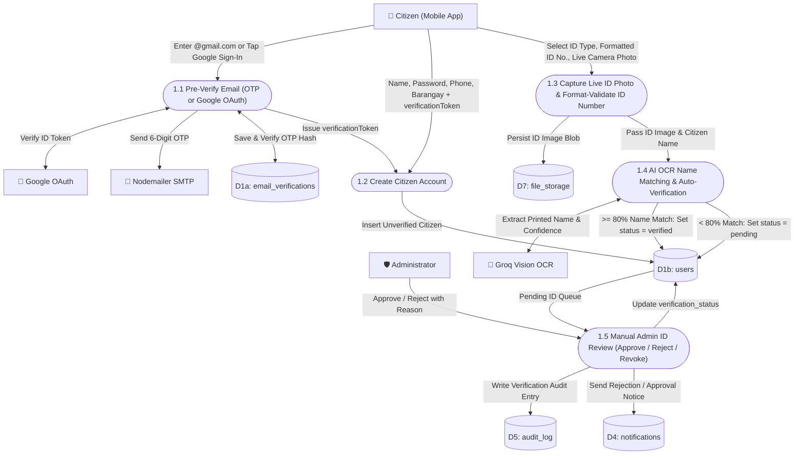
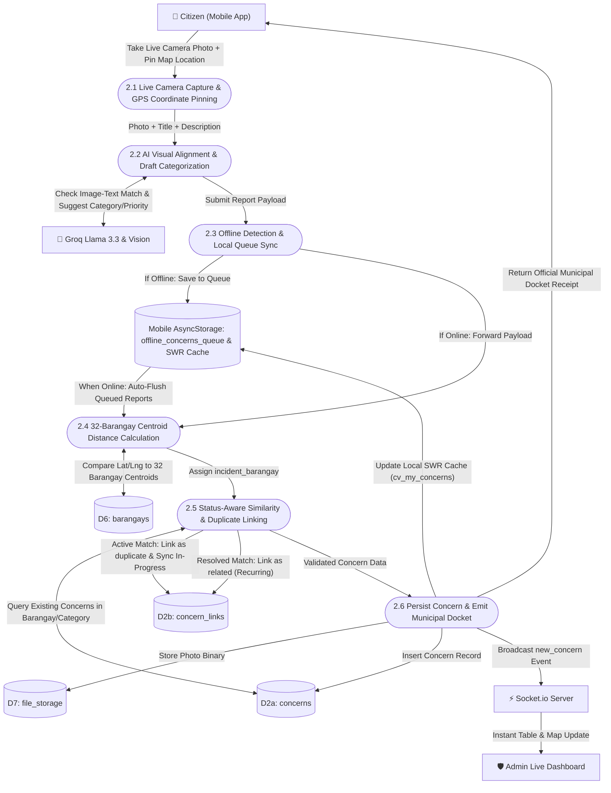
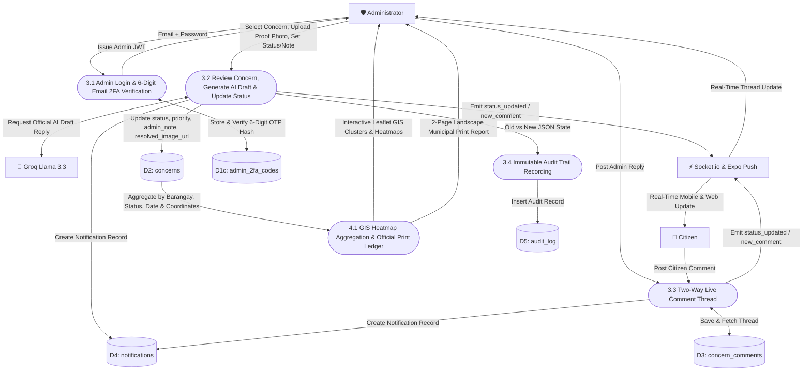

# 📊 CitiVoice — Entity-Relationship Diagram (ERD) & Data Flow Diagrams (DFD)

This document provides the complete database **Entity-Relationship Diagram (ERD)** and multi-level **Data Flow Diagrams (DFD Level 0, Level 1, and Level 2)** for the **CitiVoice** municipal reporting platform (**City of Kabankalan, Negros Occidental**).

---

## 📑 Table of Contents

1. [Entity-Relationship Diagram (ERD)](#-1-entity-relationship-diagram-erd)
   - [Visual Mermaid ERD](#11-visual-mermaid-erd)
   - [Database Relationships & Cardinality Summary](#12-database-relationships--cardinality-summary)
   - [Table & Entity Dictionary](#13-table--entity-dictionary)
2. [Data Flow Diagrams (DFD)](#-2-data-flow-diagrams-dfd)
   - [DFD Symbol Legend](#21-dfd-symbol-legend)
   - [DFD Level 0 — Context Diagram](#22-dfd-level-0--context-diagram)
   - [DFD Level 1 — System Overview Diagram](#23-dfd-level-1--system-overview-diagram)
   - [DFD Level 2.1 — Citizen Registration & Camera-Only ID Verification](#24-dfd-level-21--citizen-registration--camera-only-id-verification)
   - [DFD Level 2.2 — Concern Submission, Offline Queue & AI Triage](#25-dfd-level-22--concern-submission-offline-queue--ai-triage)
   - [DFD Level 2.3 — Admin 2FA, Incident Resolution, Live Chat & Reporting](#26-dfd-level-23--admin-2fa-incident-resolution-live-chat--reporting)
   - [Data Store Dictionary](#27-data-store-dictionary)

---

## 🗄️ 1. Entity-Relationship Diagram (ERD)

### 1.1 Visual Mermaid ERD

The schema below reflects all **10 production InnoDB tables** defined in [`backend/database/schema.sql`](backend/database/schema.sql).

---

### 1.2 Database Relationships & Cardinality Summary

| Parent Entity | Child Entity | Cardinality | Foreign Key / Join Column | Referential Action |
|---------------|--------------|-------------|---------------------------|--------------------|
| `users` | `admin_2fa_codes` | `1 : 0..1` | `admin_2fa_codes.user_id -> users.id` | `ON DELETE CASCADE` |
| `users` | `concerns` | `1 : N` | `concerns.user_id -> users.id` | `ON DELETE SET NULL` |
| `users` | `concern_comments` | `1 : N` | `concern_comments.user_id -> users.id` | `ON DELETE CASCADE` |
| `users` | `notifications` | `1 : N` | `notifications.user_id -> users.id` | `ON DELETE CASCADE` |
| `users` | `audit_log` | `1 : N` | `audit_log.changed_by -> users.id` | `ON DELETE SET NULL` |
| `concerns` | `concern_comments` | `1 : N` | `concern_comments.concern_id -> concerns.id` | `ON DELETE CASCADE` |
| `concerns` | `notifications` | `1 : N` | `notifications.concern_id -> concerns.id` | `ON DELETE CASCADE` |
| `concerns` | `concern_links` (Source) | `1 : N` | `concern_links.source_concern_id -> concerns.id` | `ON DELETE CASCADE` |
| `concerns` | `concern_links` (Target) | `1 : N` | `concern_links.target_concern_id -> concerns.id` | `ON DELETE CASCADE` |
| `barangays` | `users` / `concerns` | `1 : N` (Logical) | `barangays.name = users.barangay / concerns.incident_barangay` | Logical Reference |
| `file_storage` | `users` / `concerns` | `1 : 1` (Logical) | `file_storage.filename` referenced in media URLs | Persistent Binary Store |

---

### 1.3 Table & Entity Dictionary

1. **`users`**: Stores both `citizen` and `admin` accounts, profile fields (`phone`, `barangay`, `address`), live-captured government ID metadata (`id_type`, `id_number`, `id_image_url`), verification state (`unverified`, `pending`, `verified`, `rejected`), and Expo push token (`fcm_token`).
2. **`admin_2fa_codes`**: Holds the active bcrypt-hashed 6-digit OTP and 10-minute expiration timestamp required for Administrator Two-Factor Authentication.
3. **`email_verifications`**: Tracks pre-registration 6-digit OTP codes sent to citizen `@gmail.com` addresses prior to account creation.
4. **`barangays`**: Master list of the **32 barangays** of Kabankalan City used for resident assignment and GPS centroid matching.
5. **`concerns`**: Core civic incident table storing the report title, description, AI/citizen category, priority (`Low`, `Medium`, `High`), lifecycle status (`Pending`, `In Progress`, `Resolved`, `Rejected`), GPS coordinates (`location_lat`, `location_lng`), resident barangay vs. pinned `incident_barangay`, camera photo evidence, and official `admin_note`.
6. **`concern_links`**: Self-referencing join table linking newly submitted concerns to existing concerns as either `duplicate` (active tickets) or `related` (previously resolved tickets) with a `similarity_score`.
7. **`concern_comments`**: Stores the real-time two-way conversation messages between the reporting citizen and city administrators for each concern.
8. **`notifications`**: Stores citizen in-app notifications (status updates, admin replies, priority escalations, ID verification results) with `is_read` tracking.
9. **`audit_log`**: Immutable JSON-backed ledger recording every administrative status change, priority adjustment, and identity verification decision.
10. **`file_storage`**: Stores binary image blobs (`LONGBLOB`) alongside local disk storage so uploaded ID photos, avatars, and concern images survive ephemeral container restarts.

---

## 🔄 2. Data Flow Diagrams (DFD)

### 2.1 DFD Symbol Legend

| Component | Representation in Diagrams | Description |
|-----------|----------------------------|-------------|
| **External Entity** | `["👤 Citizen"]` / `["🛡️ Administrator"]` | Actors or third-party services outside the core backend boundary |
| **Process** | `(["1.0 Process Name"])` | Transformation, validation, AI inference, or business logic |
| **Data Store** | `[("D1: Table Name")]` | Persistent MySQL database table or local offline storage |
| **Data Flow** | `-->|Data Payload|` | Directed movement of requests, events, or records |

---

### 2.2 DFD Level 0 — Context Diagram

The **Context Diagram (Level 0)** illustrates **CitiVoice** as a single unified system interacting with its external actors and third-party cloud services.

---

### 2.3 DFD Level 1 — System Overview Diagram

**DFD Level 1** decomposes the platform into its **6 primary functional processes** and shows how data moves across the **MySQL Data Stores (`D1`–`D7`)**.

---

### 2.4 DFD Level 2.1 — Citizen Registration & Camera-Only ID Verification

This diagram details **Process 1.0**, showing how citizens verify their Gmail, register an account, and complete **Camera-Only Government ID Verification** with AI OCR auto-verification and manual admin fallback.

---

### 2.5 DFD Level 2.2 — Concern Submission, Offline Queue & AI Triage

This diagram details **Process 2.0**, illustrating how the mobile app handles **Camera-Only Evidence Capture**, **Stale-While-Revalidate (SWR) Offline Queuing**, **AI Image-to-Text Alignment**, **32-Barangay Centroid Matching**, and **Status-Aware Duplicate Detection**.

---

### 2.6 DFD Level 2.3 — Admin 2FA, Incident Resolution, Live Chat & Reporting

This diagram details **Processes 3.0 & 4.0**, covering **Administrator 2FA Sign-In**, **Incident Status Updates**, **AI-Assisted Replies**, **Real-Time Citizen-Admin Comments**, and **Official Landscape Print Reports**.

---

### 2.7 Data Store Dictionary

| Data Store ID | Physical Implementation | Contents & Purpose |
|---------------|-------------------------|--------------------|
| **`D1`** | MySQL: `users`, `admin_2fa_codes`, `email_verifications` | Citizen and administrator profiles, credentials, 2FA OTP hashes, pre-registration OTP states, and ID verification statuses. |
| **`D2`** | MySQL: `concerns`, `concern_links` | Reported civic incidents, GPS coordinates, matched barangays, status/priority states, resolution notes, and AI duplicate/related links. |
| **`D3`** | MySQL: `concern_comments` | Chronological two-way messages and image attachments between citizens and administrators. |
| **`D4`** | MySQL: `notifications` | In-app notification records linked to users and concerns with read/unread state tracking. |
| **`D5`** | MySQL: `audit_log` | Immutable JSON change history (`old_value`, `new_value`, `changed_by`) for administrative accountability. |
| **`D6`** | MySQL: `barangays` | Reference table of the 32 official barangays of Kabankalan City. |
| **`D7`** | MySQL: `file_storage` + Disk `/uploads` | Hybrid binary image storage for live camera ID photos, concern photos, resolution proof photos, and avatars. |
| **`Mobile Cache`** | Mobile `AsyncStorage` | Offline-first Stale-While-Revalidate cache (`cv_user`, `cv_my_concerns_*`, `cv_concern_detail_*`, `cv_notifications_*`, `offline_concerns_queue`). |

