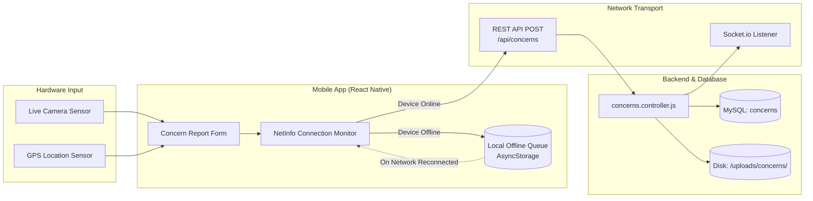
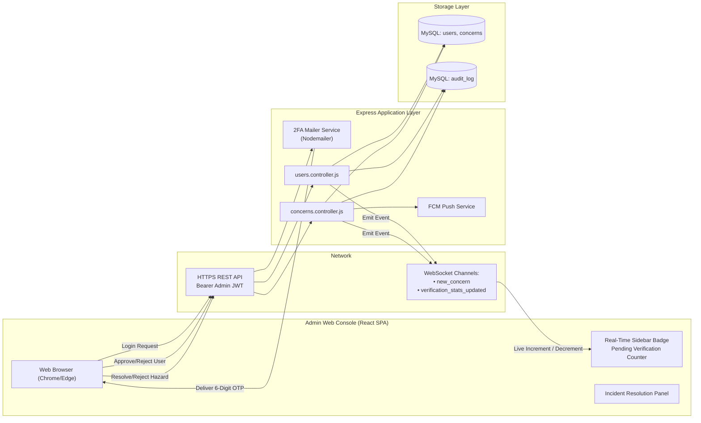
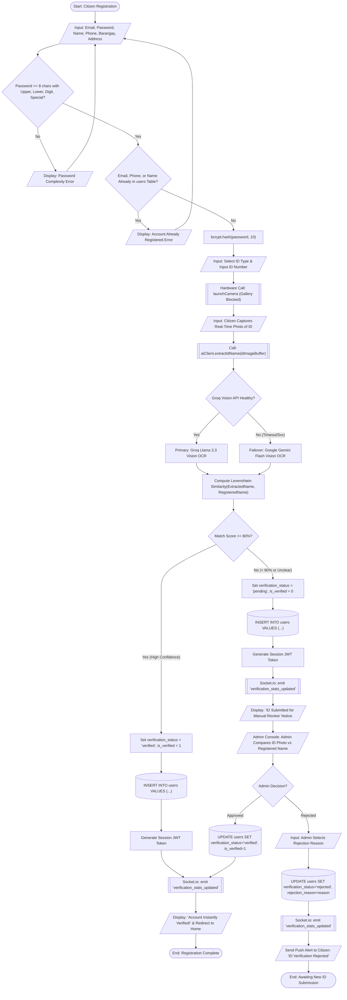
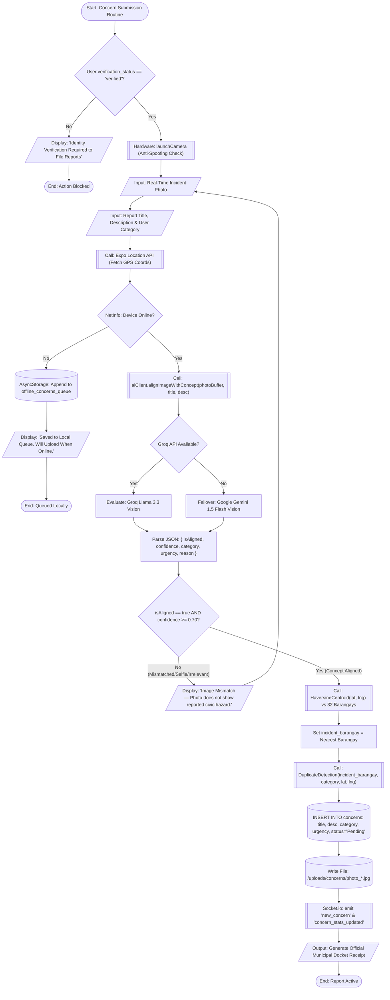
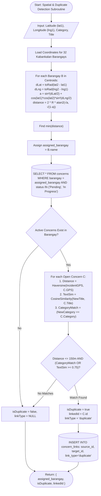
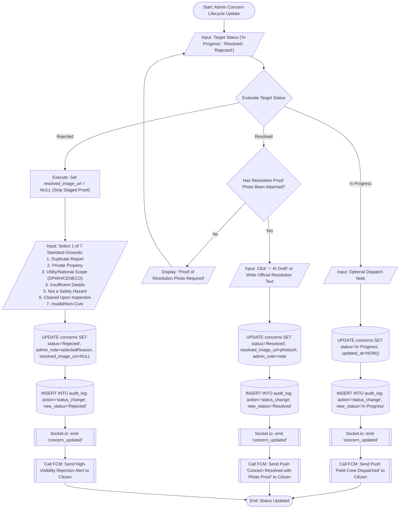
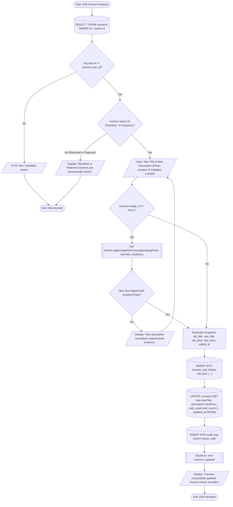

# 🧭 CitiVoice — System and Program Flowcharts
**Kabankalan City Citizen Engagement & Municipal Incident Management Platform**

---

## 📑 Document Structure & Navigation

This document is divided into two distinct engineering specifications adhering to standard Systems Analysis & Design (SAD) conventions:

1. [**PART I — SYSTEM FLOWCHARTS (High-Level Architecture & Physical Data Flow)**](#-part-i--system-flowcharts-architecture--physical-data-flow)
   - *Scope:* Broad overview of hardware, software components, external AI services, database stores, communication media, human actors, and physical outputs.
   - 1.1 [Master System Flowchart (End-to-End System Boundary)](#11-master-system-flowchart-end-to-end-system-boundary)
   - 1.2 [Citizen Mobile Subsystem & Offline Caching Flowchart](#12-citizen-mobile-subsystem--offline-caching-flowchart)
   - 1.3 [Admin Web Subsystem, 2FA & Notification Dispatch Flowchart](#13-admin-web-subsystem-2fa--notification-dispatch-flowchart)

2. [**PART II — PROGRAM FLOWCHARTS (Low-Level Algorithmic & Control Logic)**](#-part-ii--program-flowcharts-algorithmic--control-logic)
   - *Scope:* Narrow focus on specific routines, branching decisions, mathematical calculations, and step-by-step code instructions.
   - 2.1 [Standard ANSI/ISO Logic Symbol Guide](#21-standard-ansiiso-logic-symbol-guide)
   - 2.2 [Program 1: Citizen Registration & AI OCR ID Verification Algorithm](#22-program-1-citizen-registration--ai-ocr-id-verification-algorithm)
   - 2.3 [Program 2: Incident Intake & Dual-AI Visual Alignment Algorithm](#23-program-2-incident-intake--dual-ai-visual-alignment-algorithm)
   - 2.4 [Program 3: Spatial Haversine & Duplicate Hazard Detection Algorithm](#24-program-3-spatial-haversine--duplicate-hazard-detection-algorithm)
   - 2.5 [Program 4: Administrative Resolution & Standardized Rejection Algorithm](#25-program-4-administrative-resolution--standardized-rejection-algorithm)
   - 2.6 [Program 5: Citizen Concern Editing & Audit Snapshot Algorithm](#26-program-5-citizen-concern-editing--audit-snapshot-algorithm)

3. [**PART III — TRACEABILITY MATRIX**](#-part-iii--traceability-matrix)
   - Cross-references each physical system component to its specific algorithmic program flowchart.

---

# 🏛️ PART I — SYSTEM FLOWCHARTS (Architecture & Physical Data Flow)

> **Definition (System Flowchart):**  
> Depicts the **broad overview of the whole system** — tracking how data physically moves across **people (users), hardware devices, software modules, cloud microservices, communication protocols, persistent data stores, and generated outputs**.

---

### 1.1 Master System Flowchart (End-to-End System Boundary)

Illustrates the end-to-end physical data flow connecting the citizen's handheld device, network protocols, server controllers, external AI services, persistent relational storage, and administrator workstations.

```mermaid
flowchart TD
    %% Human Actors
    subgraph ACTORS ["👥 System Stakeholders"]
        CitizenUser["👤 Registered Citizen<br/>(Resident of Kabankalan)"]
        AdminUser["🛡️ Municipal Administrator<br/>(LGU Public Safety / CSWDO)"]
    end

    %% Hardware & Client Devices
    subgraph HARDWARE_LAYER ["📱 Hardware & Client Endpoints"]
        MobilePhone["Citizen Smartphone<br/>(Android / iOS Device)"]
        CameraHardware["Integrated Camera<br/>(Direct Hardware Access)"]
        GPSHardware["GPS Hardware Sensor<br/>(Latitude/Longitude)"]
        AdminWorkstation["City Hall Desktop Terminal<br/>(Web Browser / Chrome)"]
        
        MobilePhone --- CameraHardware
        MobilePhone --- GPSHardware
    end

    CitizenUser -->|Operates| MobilePhone
    AdminUser -->|Operates| AdminWorkstation

    %% Software Client Applications
    subgraph CLIENT_APPS ["💻 Software Client Applications"]
        MobileApp["CitiVoice Mobile Client<br/>(React Native 0.81 + Expo)"]
        AdminWeb["CitiVoice Admin Console<br/>(React 18 SPA + Vite/CRA)"]
    end

    MobilePhone -->|Runs| MobileApp
    AdminWorkstation -->|Accesses| AdminWeb

    %% Communication Channels & Protocols
    subgraph PROTOCOLS ["🌐 Transmission & Gateway Layer"]
        HTTPS_REST["Encrypted HTTPS REST API<br/>(JSON Payloads + JWT Tokens)"]
        WSS_SOCKET["WebSocket Channel<br/>(WSS / Socket.io v4 Engine)"]
    end

    MobileApp -->|HTTP Requests| HTTPS_REST
    MobileApp <-->|Real-Time Streams| WSS_SOCKET
    AdminWeb -->|Admin API Calls| HTTPS_REST
    AdminWeb <-->|Live Updates & Chimes| WSS_SOCKET

    %% Application Server & Backend Micro-Modules
    subgraph SERVER ["⚙️ CitiVoice Backend Application Server (Node.js & Express)"]
        AuthGateway["Auth & RBAC Middleware<br/>(bcrypt, JWT, 2FA OTP)"]
        ConcernModule["Concern Processing Engine<br/>(Validation, Centroid Matching)"]
        VerificationModule["Citizen Verification Module<br/>(Badge & Queue Manager)"]
        SocketServer["Real-Time Event Dispatcher<br/>(Socket.io Server)"]
    end

    HTTPS_REST --> AuthGateway
    HTTPS_REST --> ConcernModule
    HTTPS_REST --> VerificationModule
    WSS_SOCKET <--> SocketServer

    %% External Microservices & Cloud AI
    subgraph EXTERNAL_SERVICES ["☁️ External Cloud Microservices"]
        DualAIEngine["Dual-AI Vision Client<br/>• Primary: Groq Llama 3.3 70B<br/>• Fallback: Google Gemini 1.5 Flash"]
        SMTPService["SMTP Nodemailer Relay<br/>(Official City Gmail Gateway)"]
        FCMService["Firebase Cloud Messaging (FCM)<br/>(Push Notification Daemon)"]
    end

    ConcernModule <-->|Image Semantic Alignment| DualAIEngine
    VerificationModule <-->|ID OCR & Name Extraction| DualAIEngine
    AuthGateway -->|Send 2FA & OTP Codes| SMTPService
    ConcernModule -->|Trigger Push Alerts| FCMService

    %% Data Stores & Files
    subgraph DATA_STORES ["💾 Persistent Storage Media"]
        MySQL_DB[("MySQL 8.0 Relational DB<br/>• users, concerns, audit_log<br/>• concern_links, otp_codes")]
        MediaStorage[("Server File Storage<br/>(Local Storage / uploads/)")]
        DeviceStorage[("Device AsyncStorage<br/>(Offline Queue & Cache)")]
    end

    MobileApp <-->|Offline Caching| DeviceStorage
    ConcernModule -->|Read / Write| MySQL_DB
    VerificationModule -->|Read / Write| MySQL_DB
    AuthGateway -->|Read / Write| MySQL_DB
    ConcernModule -->|Persist Images| MediaStorage
    VerificationModule -->|Persist ID Photos| MediaStorage

    %% Output Documents & Displays
    subgraph OUTPUTS ["📄 Physical Outputs & UI Displays"]
        DocketOutput[/"Citizen Official Docket Receipt<br/>(Tracking Number + Timeline)"/]
        AdminHeatmap[/"GIS Incident Heatmap & Dashboard<br/>(Spatial Markers & KPI Cards)"/]
        ResolutionReport[/"Exported Municipal Reports<br/>(Excel .XLSX / PDF Records)"/]
    end

    MobileApp --> DocketOutput
    AdminWeb --> AdminHeatmap
    AdminWeb --> ResolutionReport
```

---

### 1.2 Citizen Mobile Subsystem & Offline Caching Flowchart

Shows the flow of data from mobile sensors, through offline SQLite/AsyncStorage storage, over HTTPS/WSS, to server-side controllers.

---

### 1.3 Admin Web Subsystem, 2FA & Notification Dispatch Flowchart

Shows the data flow during administrative oversight, real-time sidebar badge synchronization, dual-factor authentication, and citizen notification fan-out.

---

# ⚙️ PART II — PROGRAM FLOWCHARTS (Algorithmic & Control Logic)

> **Definition (Program Flowchart):**  
> Depicts the **narrow focus on a single program, script, or algorithm** — mapping out control flow, decision branches (`if/else`), arithmetic calculations, error handling loops, and sequential instructions using strict ANSI/ISO symbols.

---

### 2.1 Standard ANSI/ISO Logic Symbol Guide

| Symbol | Syntax | Standard Function |
| :---: | :---: | :--- |
| **Terminal** | `([Start / End])` | Indicates the start, end, or exit point of the program. |
| **Input / Output** | `[/Input or Output/]` | Data entered by the user (camera, keyboard) or output displayed to the screen. |
| **Process** | `[Instruction / Computation]` | Single code statement, assignment, database query, or computation. |
| **Decision** | `{"Conditional Check?"}` | Evaluates a Boolean condition with explicit `True / Yes` and `False / No` paths. |
| **Subroutine** | `[["Subroutine / Function Call"]]` | Reference to a separate named function or external client module. |
| **Database Transaction** | `[("SQL Transaction")]` | Read, insert, update, or delete transaction on a persistent table. |

---

### 2.2 Program 1: Citizen Registration & AI OCR ID Verification Algorithm

**Source Controller:** `backend/controllers/auth.controller.js` & `backend/controllers/users.controller.js`  
**Purpose:** Handles pre-registration validation, password hashing, anti-spoofing camera capture, and automated AI OCR name matching with manual admin fallback.

---

### 2.3 Program 2: Incident Intake & Dual-AI Visual Alignment Algorithm

**Source Controller:** `backend/controllers/concerns.controller.js` & `backend/services/aiClient.js`  
**Purpose:** Validates citizen photo evidence, checks semantic alignment against report description, calculates urgency score, and saves incident.

---

### 2.4 Program 3: Spatial Haversine & Duplicate Hazard Detection Algorithm

**Source Controller:** `backend/controllers/concerns.controller.js` (Spatial Subroutine)  
**Purpose:** Calculates nearest barangay centroid and identifies duplicate open reports in the same geographic zone.

---

### 2.5 Program 4: Administrative Resolution & Standardized Rejection Algorithm

**Source Controller:** `backend/controllers/concerns.controller.js`  
**Purpose:** Enforces strict municipal accountability rules: status dispatch, proof photo attachment, AI response drafting, and standardized rejection classification.

---

### 2.6 Program 5: Citizen Concern Editing & Audit Snapshot Algorithm

**Source Controller:** `backend/controllers/concerns.controller.js`  
**Purpose:** Restricts editing to open tickets, re-evaluates visual alignment against existing photos, and preserves historical version snapshots.

---

# 📌 PART III — TRACEABILITY MATRIX

This table cross-references each physical system element from the **System Flowcharts (Part I)** with its implementing algorithmic logic in the **Program Flowcharts (Part II)**:

| System Flowchart Component | Operational Role | Corresponding Program Flowchart | Source File / Implementation |
| :--- | :--- | :--- | :--- |
| **Citizen Smartphone (Camera & GPS)** | Captures anti-spoofing live photos & coordinates | **Program 2** *(Incident Intake Algorithm)* | `mobile/src/screens/citizen/SubmitConcernScreen.jsx` |
| **Dual-AI Vision Client** | Llama 3.3 / Gemini Flash failover alignment | **Program 2** & **Program 5** *(Vision Subroutine)* | `backend/services/aiClient.js` |
| **Centroid & Duplicate Engine** | Haversine distance & spatial similarity | **Program 3** *(Spatial Duplicate Detection)* | `backend/controllers/concerns.controller.js` |
| **OCR Verification Subsystem** | Government ID name extraction & matching | **Program 1** *(ID Verification Algorithm)* | `backend/controllers/users.controller.js` |
| **Sidebar Real-Time Badge** | Live indicator for pending citizen queue | **Program 1** & **Program 4** *(Socket Sync)* | `admin-web/src/components/Sidebar.jsx` |
| **Admin Incident Resolution Panel** | Enforces proof photo & standardized rejection | **Program 4** *(Resolution & Rejection Algorithm)* | `admin-web/src/pages/Concerns.jsx` |
| **Version History Snapshot Engine** | Immutable audit trail for edited concerns | **Program 5** *(Concern Editing Algorithm)* | `backend/models/concern.model.js` |
| **Database & File Media Store** | Relational integrity & image persistence | **All Programs (1 to 5)** | `backend/db.js` & `backend/uploads/` |
