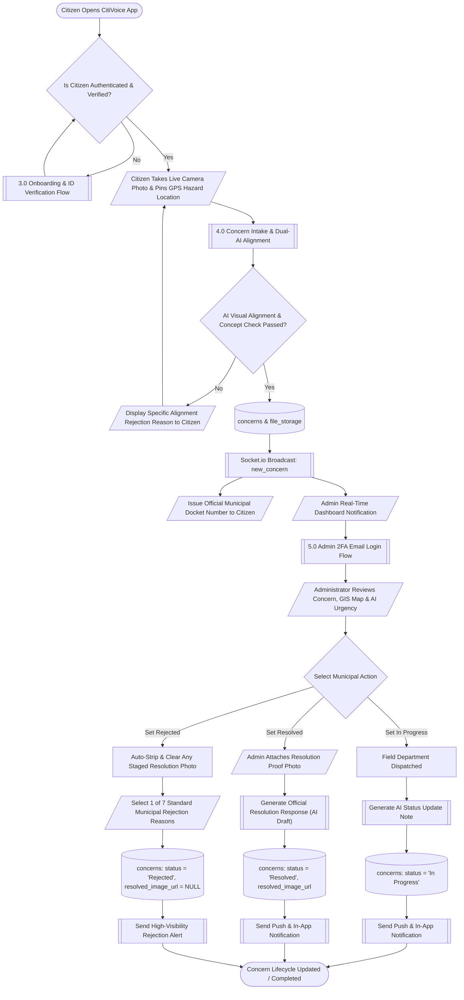
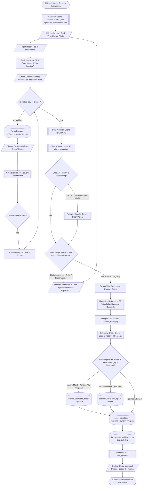
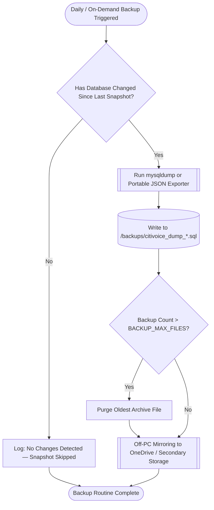

# 🧭 CitiVoice — System Flowcharts

This document provides the complete, production-grade **System Flowcharts** for the **CitiVoice** municipal civic reporting platform (**City of Kabankalan, Negros Occidental**). 

Unlike Data Flow Diagrams (which map data movements), these system flowcharts map the **step-by-step operational control flows, decision logic, automated background workers, AI validation checkpoints, and database transactions** across the citizen mobile app and administrative web console.

---

## 📑 Table of Contents

1. [Flowchart Symbol Conventions](#-1-flowchart-symbol-conventions)
2. [Master End-to-End System Flowchart](#-2-master-end-to-end-system-flowchart)
3. [Citizen Onboarding & Smart Camera-Only ID Verification Flowchart](#-3-citizen-onboarding--smart-camera-only-id-verification-flowchart)
4. [Concern Intake, Dual-AI Visual Alignment & Duplicate Detection Flowchart](#-4-concern-intake-dual-ai-visual-alignment--duplicate-detection-flowchart)
5. [Administrator 2FA Authentication & Incident Resolution Lifecycle Flowchart](#-5-administrator-2fa-authentication--incident-resolution-lifecycle-flowchart)
6. [Citizen Concern Editing & Version History Flowchart](#-6-citizen-concern-editing--version-history-flowchart)
7. [Automated Database Backup Routine Flowchart](#-7-automated-database-backup-routine-flowchart)

---

## 🔣 1. Flowchart Symbol Conventions

Standard ANSI/ISO flowchart notations used across all diagrams:

| Symbol Shape | Mermaid Syntax | Description & Meaning |
| :---: | :---: | :--- |
| **Terminal** | `([Start / End])` | Entry point, exit point, or termination boundary of a subsystem. |
| **Process** | `[System Action / Computation]` | Automated calculation, data transformation, or background execution. |
| **Decision** | `{"Conditional Check?"}` | Branching point evaluating a Boolean condition (`Yes / True` or `No / False`). |
| **Input / Output** | `[/User Input or Display/]` | Manual user input (forms, camera, taps) or interface display output. |
| **Database Storage** | `[("Persistent Table")]` | Direct write, read, or update to the MySQL 8.0 relational database. |
| **Subroutine / External API** | `[["External Service / AI Engine"]]` | Third-party microservice, cloud AI provider, or hardware subsystem. |

---

## 🌐 2. Master End-to-End System Flowchart

The high-level lifecycle of a civic concern from citizen camera capture to administrative municipal resolution or standardized rejection.



---

## 🪪 3. Citizen Onboarding & Smart Camera-Only ID Verification Flowchart

Illustrates pre-registration email authentication, anti-spoofing live camera capture, and automated AI OCR name matching with manual administrator fallback.

```mermaid
flowchart TD
    Start([Citizen Begins Registration]) --> AuthMethod{"Choose Verification Method"}
    
    %% Google OAuth Flow
    AuthMethod -- "Google Sign-In" --> GoogleOAuth[["Google OAuth 2.0 (expo-auth-session)"]]
    GoogleOAuth --> TokenVerify{"Google ID Token Valid?"}
    TokenVerify -- "No" --> GoogleFail[/Display OAuth Error Notice/]
    GoogleFail --> Start
    TokenVerify -- "Yes" --> IssueToken1[Issue Pre-Registration verificationToken]
    
    %% Email OTP Flow
    AuthMethod -- "Gmail OTP" --> EnterEmail[/Enter @gmail.com Address/]
    EnterEmail --> SendOTP[["Nodemailer: Send 6-Digit Verification Code"]]
    SendOTP --> SaveOTP[(email_verifications)]
    SaveOTP --> PromptOTP[/Input 6-Digit Code in App/]
    PromptOTP --> CheckOTP{"OTP Matches & Not Expired?"}
    CheckOTP -- "No (or Expired)" --> PromptRetry[/Display Invalid Code Alert (Cooldown 45s)/]
    PromptRetry --> PromptOTP
    CheckOTP -- "Yes" --> IssueToken2[Issue Pre-Registration verificationToken]
    
    IssueToken1 --> ProfileForm[/Complete Profile: Name, Password, Phone, Barangay, Address/]
    IssueToken2 --> ProfileForm
    
    ProfileForm --> CreateUser[(Insert users: role='citizen', verification_status='unverified')]
    CreateUser --> PromptID[/Open Smart ID Verification Modal/]
    
    PromptID --> SelectIDType[/Select 1 of 10 Valid Philippine Government ID Types/]
    SelectIDType --> FormatCheck{"Matches ID Format Pattern?"}
    FormatCheck -- "No" --> FormatErr[/Display Input Mask Requirement Alert/]
    FormatErr --> SelectIDType
    
    FormatCheck -- "Yes" --> LiveCamera[["Hardware Camera: launchCamera (Gallery Blocked)"]]
    LiveCamera --> SnapID[/Citizen Captures Clear ID Photo/]
    SnapID --> PersistID[(file_storage: id_image_url)]
    
    PersistID --> TriggerOCR[["AI OCR Name Matching (Groq Llama 3.3 Vision)"]]
    TriggerOCR --> OCRStatus{"Groq OCR Successful?"}
    OCRStatus -- "Fail / Outage" --> GeminiOCR[["Fallback: Google Gemini Flash Vision"]]
    OCRStatus -- "Success" --> EvaluateMatch
    GeminiOCR --> EvaluateMatch{"Extracted Name Matches Registered Legal Name?"}
    
    EvaluateMatch -- ">= 80% Match Score" --> AutoVerify[Set verification_status = 'verified']
    AutoVerify --> UpdateVerified[(users: is_verified = 1)]
    UpdateVerified --> NotifVerified[/Notify Citizen: ID Instantly Approved/]
    NotifVerified --> FinishVerified([Citizen Ready to Report Concerns])
    
    EvaluateMatch -- "< 80% Match Score" --> FlagPending[Set verification_status = 'pending']
    FlagPending --> UpdatePending[(users: is_verified = 0)]
    UpdatePending --> QueueAdmin[/Place in Administrator Verification Queue/]
    
    QueueAdmin --> AdminInspect[/Administrator Compares ID Photo vs Registered Name/]
    AdminInspect --> AdminDecision{"Admin Verification Decision"}
    
    AdminDecision -- "Approve" --> SetApproved[(users: verification_status = 'verified')]
    SetApproved --> Audit1[(audit_log)]
    Audit1 --> FinishVerified
    
    AdminDecision -- "Reject" --> EnterRejectionReason[/Select / Type Rejection Reason/]
    EnterRejectionReason --> SetRejected[(users: verification_status = 'rejected')]
    SetRejected --> Audit2[(audit_log)]
    Audit2 --> NotifyRejection[/Citizen Notified to Re-submit Valid ID Photo/]
    NotifyRejection --> FinishRejected([ID Rejected — Re-attempt Available])
```

---

## 📷 4. Concern Intake, Dual-AI Visual Alignment & Duplicate Detection Flowchart

Demonstrates live camera intake, offline local queue caching, dual-AI semantic alignment, 32-barangay spatial mapping, and similarity linking.



---

## 🛡️ 5. Administrator 2FA Authentication & Incident Resolution Lifecycle Flowchart

Illustrates two-factor email OTP administrator authentication, GIS dashboard triage, official AI response drafting, and the strict rejection workflow.

```mermaid
flowchart TD
    Start([Administrator Navigates to /login]) --> EnterCredentials[/Enter Email & Password/]
    EnterCredentials --> CheckCreds{"Password Hash Matches (bcrypt) & Role = 'admin'?"}
    
    CheckCreds -- "No" --> CredsError[/Display 'Invalid Credentials' Error/]
    CredsError --> EnterCredentials
    
    CheckCreds -- "Yes" --> GenOTP[Generate Secure 6-Digit OTP]
    GenOTP --> Save2FA[(admin_2fa_codes: otp_hash, expires_at = NOW + 10m)]
    Save2FA --> SendAdminEmail[["Nodemailer: Deliver 2FA Code to Admin Official Email"]]
    SendAdminEmail --> IssueMFAToken[Issue Ephemeral mfaToken]
    
    IssueMFAToken --> Prompt2FA[/Enter 6-Digit 2FA Code (45s Resend Cooldown)/]
    Prompt2FA --> Verify2FA{"OTP Valid & Not Expired?"}
    
    Verify2FA -- "No" --> OTPError[/Display 'Invalid Code' Notice/]
    OTPError --> Prompt2FA
    
    Verify2FA -- "Yes" --> Delete2FA[(Delete admin_2fa_codes Entry)]
    Delete2FA --> IssueAdminJWT[Issue Full Admin JWT Session Cookie]
    
    IssueAdminJWT --> AdminDashboard[/Admin Dashboard: GIS Heatmap, Status Lists, KPI Cards/]
    AdminDashboard --> SelectTicket[/Open Specific Concern Detail Drawer/]
    
    SelectTicket --> DecideStatus{"Target Status Selection"}
    
    %% Branch: In Progress
    DecideStatus -- "In Progress" --> DraftProgressNote[/Optional Admin Dispatch Note/]
    DraftProgressNote --> SaveProgress[(Update concerns: status = 'In Progress')]
    SaveProgress --> LogAudit1[(audit_log: action = 'status_change')]
    LogAudit1 --> NotifyProgress[[Push Alert & In-App Notification: Crew Dispatched]]
    
    %% Branch: Resolved
    DecideStatus -- "Resolved" --> AttachResolvedPhoto[/Attach Resolution Proof Photo (Required/Optional)/]
    AttachResolvedPhoto --> ClickAIDraft[/Click '✨ AI Draft' or Write Official Response/]
    ClickAIDraft --> GenResolvedAI[["AI Engine: Draft Formal Municipal Resolution Notice"]]
    GenResolvedAI --> SaveResolved[(Update concerns: status = 'Resolved', resolved_image_url)]
    SaveResolved --> LogAudit2[(audit_log: action = 'status_change')]
    LogAudit2 --> NotifyResolved[[Push Alert: Hazard Resolved with Proof]]
    
    %% Branch: Rejected
    DecideStatus -- "Rejected" --> ClearPhoto[Strip & Clear Resolution Photo: resolved_image_url = NULL]
    ClearPhoto --> DisableAIDraft[Disable Auto-Generated AI Text Response]
    DisableAIDraft --> SelectReason[/Select 1 of 7 Standardized Municipal Grounds:
    1. Duplicate Report
    2. Private Property (Outside Jurisdiction)
    3. Utility / National Scope (DPWH / CENECO)
    4. Insufficient Details (Lacks Landmark)
    5. Not a Public Safety Hazard
    6. Already Cleared Upon Inspection
    7. Invalid / Non-Civic Submission/]
    SelectReason --> SaveRejected[(Update concerns: status = 'Rejected', admin_note = Reason)]
    SaveRejected --> LogAudit3[(audit_log: action = 'status_change')]
    LogAudit3 --> NotifyRejected[[Push Alert: High-Visibility Rejection Card Displayed]]
    
    NotifyProgress --> RealtimeSync[[Socket.io: emit 'status_updated']]
    NotifyResolved --> RealtimeSync
    NotifyRejected --> RealtimeSync
    RealtimeSync --> End([Concern Lifecycle Updated])
```

---

## ✏️ 6. Citizen Concern Editing & Version History Flowchart

Details the operational constraints governing citizen modifications to active reports, visual re-alignment, and audit version snapshot creation.

```mermaid
flowchart TD
    Start([Citizen Opens Submitted Concern in App]) --> EditBtnClicked[/Tap 'Edit Concern' Button/]
    EditBtnClicked --> CheckStatus{"Is Status 'Pending' or 'In Progress'?"}
    
    CheckStatus -- "No (Resolved or Rejected)" --> BlockEdit[/Display Notice: Locked — Completed/Closed Reports Cannot Be Modified/]
    BlockEdit --> End([Edit Aborted])
    
    CheckStatus -- "Yes" --> PresentForm[/Display Edit Modal: Title & Description Editable
    (Category, Pinned Location & Live Photo are Permanently Locked)/]
    
    PresentForm --> SubmitChanges[/Submit Updated Title & Description/]
    SubmitChanges --> HasImage{"Does Concern Have an Attached Incident Photo?"}
    
    HasImage -- "Yes" --> ReVerifyAI[["Dual-AI Vision: Verify New Title & Description Against Photo"]]
    ReVerifyAI --> CheckAlignment{"Does Updated Text Still Align with Photo?"}
    
    CheckAlignment -- "No" --> ShowMismatch[/Reject Edit: Updated text contradicts original photo evidence/]
    ShowMismatch --> PresentForm
    
    CheckAlignment -- "Yes" --> PrepareSnapshot
    HasImage -- "No" --> PrepareSnapshot
    
    PrepareSnapshot[Assemble Old Values vs New Values]
    PrepareSnapshot --> InsertHistory[(Insert concern_edit_history:
    old_title, new_title,
    old_description, new_description,
    change_summary, edited_by, edited_at)]
    
    InsertHistory --> UpdateConcern[(Update concerns:
    title = new_title,
    description = new_description,
    edit_count = edit_count + 1,
    last_edited_at = NOW())]
    
    UpdateConcern --> RecordAudit[(Insert audit_log: action = 'citizen_edit')]
    RecordAudit --> EmitEdit[[Socket.io: emit 'concern_updated']]
    EmitEdit --> UpdateUI[/Instant Refresh on Mobile App & Admin Web Drawer/]
    UpdateUI --> EndSuccess([Edit Recorded & Audit History Appended])
```

---

## 💾 7. Automated Database Backup Routine Flowchart

Illustrates the background cron jobs and automated backup daemons maintaining disaster recovery, change detection, and file rotation.



---

## 📌 Summary Matrix of System Operations

| Subsystem / Routine | Trigger Actor / Event | Key Decision / Checkpoint | Primary Database Tables Affected | Real-Time Sync Channel |
| :--- | :--- | :--- | :--- | :--- |
| **Citizen Registration** | Citizen (`/register`) | Email OTP / Google OAuth token validation | `users`, `email_verifications` | REST API |
| **ID Verification** | Citizen (Mobile Modal) | AI OCR Name match score (`>= 80%`) | `users`, `file_storage`, `audit_log` | Socket.io / Push |
| **Concern Intake** | Citizen (`/concerns`) | Dual-AI photo-to-concept visual alignment | `concerns`, `file_storage`, `concern_links` | Socket.io (`new_concern`) |
| **Admin Login (2FA)** | Admin (`/login`) | 6-digit email OTP expiry & hash match | `admin_2fa_codes`, `users` | REST API |
| **Resolution Lifecycle** | Admin (`/concerns/:id`) | Target status (`In Progress`, `Resolved`, `Rejected`) | `concerns`, `audit_log`, `notifications` | Socket.io (`status_updated`) |
| **Concern Editing** | Citizen (`/edit`) | Status is editable (`Pending` / `In Progress`) | `concerns`, `concern_edit_history`, `audit_log` | Socket.io (`concern_updated`) |
| **Database Backup** | Scheduled Cron / Admin | Change detection since last snapshot | `/backups/*.sql`, `/backups/*.json` | Admin Console |

